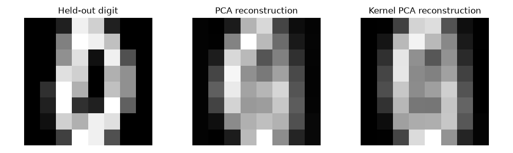

# Digit Manifold Compression

Validation-selected kernel PCA and held-out digit reconstruction.

**Author and maintainer:** Abhinav Tanwar.

## Run

Requires Python 3.12. Install dependencies with `python -m pip install -r requirements.txt`.

```sh
python analysis.py
python -m unittest discover -s tests
```

## Methods and limitations

Uses the offline sklearn digits dataset. A training/validation/test split isolates kernel gamma selection from test reconstruction scores. Scaling is fitted only on training pixels. Kernel PCA is compared with ordinary PCA using two components and reconstruction in standardized feature space. Reconstructed pixels are inverse-scaled only for visualization. Class labels do not enter the compression transform.

## Measured results


[Full calculated metrics](results/metrics.json) · [Input provenance](data/README.md) · [Method changes](docs/methodology.md). Open `report.html` for the visual summary.



The clean notebook in `notebooks/` delegates to the same module. Notebook cells were syntax-checked with outputs cleared; native scripts and tests were executed.
